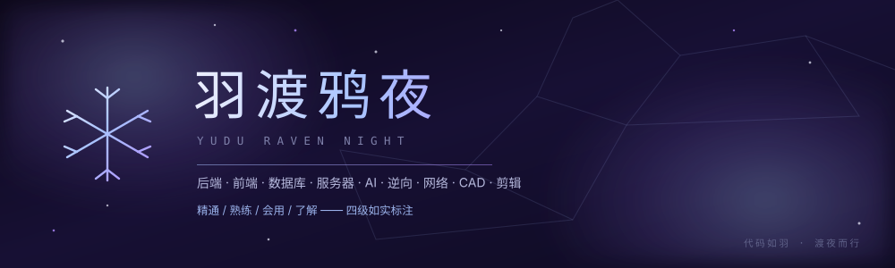

# 羽渡鸦夜 · Yudu Raven Night

个人名片页。单页、零依赖、零构建 —— 打开 `index.html` 就能看。



---

## 内容

一份以**技能**为主体的工程名片。性格只体现在视觉设计里，不作文字说明。

- **技能矩阵** —— 四级如实标注：精通 / 熟练 / 会用 / 了解
- **专长领域** —— 后端、前端、数据库、服务器、AI、逆向、网络通信
- **AI 工程** —— 应用层与研发流程，以及日常在用的模型工具
- **作品** —— 覆盖后端、系统、全栈、AI 检索、逆向协议分析

视觉上用**棱角表达冷淡，圆润表达温度**：细线、方角、衬线字，配少量圆角与粉色点缀。

## 特性

| | |
|---|---|
| **零依赖** | 无框架、无 CDN、无构建，纯 HTML + CSS + JS |
| **零外链** | 系统字体栈，图标全内联 SVG，断网可完整显示 |
| **自适应** | 1000px / 700px / 420px 三档断点 |
| **可访问** | 语义标签、跳转链接、焦点样式、`aria` 属性 |
| **尊重偏好** | 响应 `prefers-reduced-motion`，禁用动画不影响内容 |
| **无注释** | 源码不含注释 |
| **打印友好** | 打印样式自动转白底黑字 |

## 文件结构

```
.
├── index.html              # 单页主体
├── assets/
│   ├── css/style.css       # 全部样式
│   ├── js/main.js          # 全部交互
│   └── img/preview.svg     # 预览图（也是 GitHub 主页横幅）
├── LICENSE
└── README.md
```

## 本地预览

双击 `index.html` 即可。

用本地服务器更稳妥（剪贴板 API 在 `file://` 下会被浏览器禁用）：

```bash
python -m http.server 8080
# 打开 http://localhost:8080
```

## 部署到 GitHub Pages

```bash
git init
git add .
git commit -m "feat: 个人名片页"
git branch -M main
git remote add origin https://github.com/YuDu-Yaye/yudu-raven-night.git
git push -u origin main
```

再到仓库 **Settings → Pages**，把 Source 设为 `main` 分支的 `/ (root)`。

> 若 `git push` 报连接失败，多半是 DNS 问题，可临时挂代理：
> `git config --global http.proxy http://127.0.0.1:7890`

## 想改成自己的

1. **`index.html`** —— 搜索 `羽渡鸦夜` 换名字；`#contact` 里的 GitHub / 邮箱 / 微信换成你的
2. **技能分级** —— 四个 `.tier` 区块里的 `<li>`，以及 `data-count` 数量
3. **专长领域** —— 七个 `.domain` 卡片的描述与标签
4. **作品** —— `.work` 卡片的项目名、描述与技术栈
5. **配色** —— `assets/css/style.css` 顶部 `:root` 变量，改 `--ice-*`（冰蓝）、`--vi-*`（紫）、`--lv1`~`--lv4`（四级配色）

## 许可

[MIT](LICENSE)

---

<p align="center">
  <sub>代码如羽 · 渡夜而行</sub>
</p>
